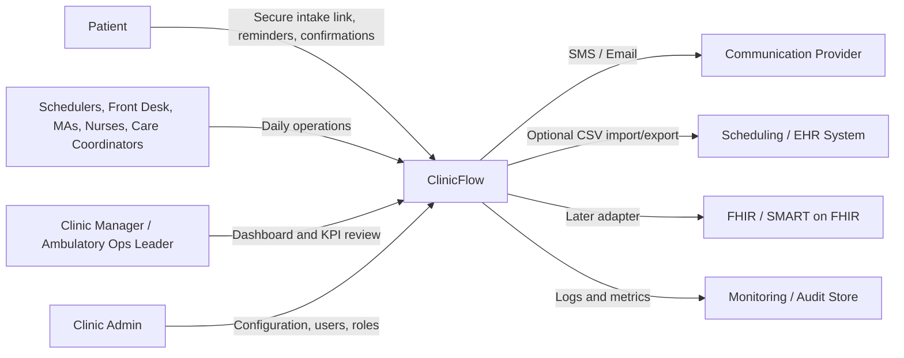
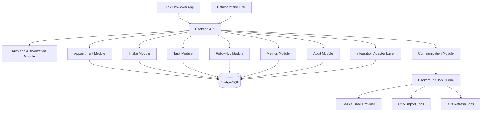
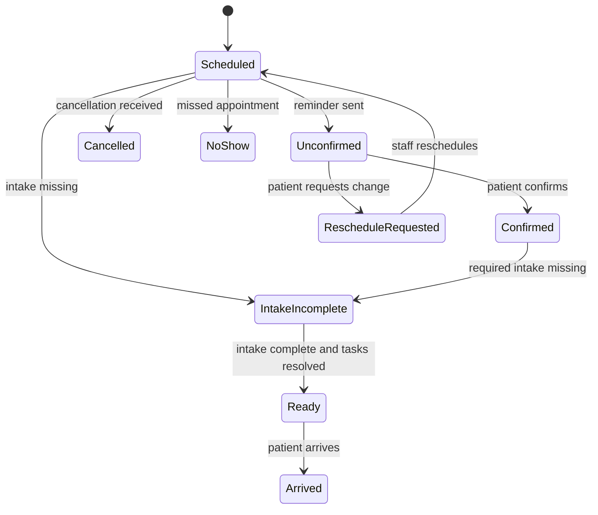

# 01 - System Architecture

## Architecture Mandate

ClinicFlow is an operational control layer for hospitals and high-volume outpatient clinics. The architecture must serve the approved Product Bible:

- Improve appointment readiness, intake completion, task ownership, follow-up reliability, and operational visibility.
- Avoid clinical diagnosis, autonomous clinical advice, EHR replacement, billing, medication management, and prior authorization automation in the MVP.
- Start beside existing systems through manual entry, CSV import, mock data, or lightweight scheduling integration.
- Preserve a path toward FHIR/SMART on FHIR and EHR write-back later without making them MVP blockers.
- Keep every module reusable enough to become a Sevora product primitive in future operational products.

## Architectural Style

Use a modular monolith for the MVP.

This gives ClinicFlow:

- Faster implementation than microservices.
- Strong transactional consistency for appointment, task, intake, and follow-up state.
- Easier security review and audit logging.
- Lower operational overhead for the first pilot.
- Clear internal module boundaries that can later be extracted if scale requires it.

Do not use microservices for MVP. ClinicFlow does not yet have the operational complexity, team size, or scale profile to justify distributed system overhead.

## System Context

## Product Modules

ClinicFlow should be implemented as independently testable modules inside one application.

| Module | Responsibility | Product Bible Alignment |
| --- | --- | --- |
| Organization | Clinics, locations, departments, staff, role configuration. | Supports hospital and multisite clinic structure. |
| Patient Registry | Minimum necessary patient identity and contact data. | Avoids EHR replacement and unnecessary clinical data. |
| Appointment Command Center | Daily schedule, appointment status, readiness state, filters. | Targets no-shows, utilization, readiness, and staff touches. |
| Intake | Configurable pre-visit checklists and patient completion tracking. | Targets intake completion before visit. |
| Communications | SMS/email reminders, confirmations, cancellation/reschedule requests. | Targets patient response time and schedule recovery. |
| Task Board | Owner, due time, status, aging, escalation, handoff notes. | Eliminates ownerless operational work. |
| Follow-Up | Due dates, response state, completion, missed follow-up queue. | Improves follow-up reliability. |
| Metrics | KPI definitions, dashboard aggregates, pilot success reporting. | Makes buyer value measurable. |
| Audit | Immutable activity history for patient communication and staff changes. | Required for healthcare trust and compliance posture. |
| Integration Adapters | CSV import/export first, FHIR later, messaging provider adapters. | Keeps integrations optional and replaceable. |

## Runtime Architecture

## Core Domain Flow

Appointment readiness is the central operating concept.

## Module Dependency Rules

- API routes can call application services.
- Application services can call domain services, repositories, adapters, and audit services.
- Domain entities must not call infrastructure code.
- Communications, imports, and metrics refreshes must run through job abstractions.
- Audit events must be emitted by every state-changing workflow.
- Modules must communicate through typed service contracts, not direct table access across module boundaries.

## Cross-Cutting Requirements

### Auditability

Every meaningful event must record:

- Organization.
- Actor or system source.
- Patient or appointment reference when applicable.
- Before and after state for critical fields.
- Timestamp.
- Request or job correlation ID.

### Minimum Necessary Data

Store only what ClinicFlow needs for operations:

- Patient name.
- Date of birth or age marker if required by pilot.
- Contact details.
- Appointment linkage.
- Intake completion metadata.
- Operational notes.

Do not store diagnosis, treatment plans, medication lists, lab results, clinical notes, or billing data in MVP.

### Extensibility

Design all external dependencies behind adapters:

- Messaging provider adapter.
- Import/export adapter.
- Future FHIR adapter.
- Future AI provider adapter.
- Future analytics warehouse adapter.

## MVP Architecture Boundaries

### In Scope

- Web application for staff and managers.
- Patient-facing intake and confirmation links.
- Backend API.
- Relational database.
- Background job processing.
- SMS/email integration.
- Audit log.
- KPI dashboard.
- CSV/manual import path.

### Out Of Scope

- Native mobile apps.
- EHR write-back.
- Clinical AI.
- Claims or billing.
- Prior authorization automation.
- Real-time enterprise data warehouse integration.
- Multi-region active-active deployment.

## Initial Implementation Units

1. Organization, users, roles, and permissions.
2. Patient registry with minimum necessary data.
3. Appointment model and readiness state machine.
4. Intake checklist model and patient link flow.
5. Communication events and reminder jobs.
6. Task board with ownership and aging.
7. Follow-up tracker.
8. Metrics aggregation.
9. Audit log.
10. CSV/manual data import.

## Architecture Acceptance Criteria

Implementation can begin when:

- Each MVP module has a clear domain model and API boundary.
- Database schema supports the appointment readiness state machine.
- Audit events are specified for every state transition.
- Role access rules are defined for all user types.
- Patient communication consent rules are defined.
- Background job behavior is documented.
- Security controls are explicit and testable.
