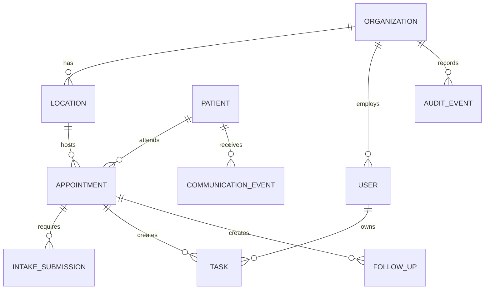

# 03 - Database Architecture

## Database Mandate

ClinicFlow's database must support operational workflow integrity, minimum necessary patient data, auditability, and KPI reporting.

The database is not an EHR. It must not become a dumping ground for clinical data.

## Recommended Database

Use PostgreSQL as the primary database.

Reasons:

- Strong relational constraints for appointments, tasks, users, and organizations.
- Mature transaction support for workflow state transitions.
- Flexible JSONB for configurable intake templates without abandoning relational structure.
- Strong indexing for operational dashboards.
- Mature backup, encryption, replication, and managed-hosting support.

## Data Ownership Boundaries

## Core Entities

### organizations

Represents a hospital, clinic network, or pilot customer.

Core fields:

- id.
- name.
- status.
- timezone.
- created_at.
- updated_at.

### locations

Represents clinic sites, departments, or outpatient locations.

Core fields:

- id.
- organization_id.
- name.
- type.
- timezone.
- status.

### users

Represents staff, managers, admins, and support users.

Core fields:

- id.
- organization_id.
- email.
- name.
- role.
- status.
- last_login_at.

### user_location_access

Maps users to locations or departments.

Core fields:

- user_id.
- location_id.
- access_level.

### patients

Stores minimum necessary patient identity and contact information.

Core fields:

- id.
- organization_id.
- external_patient_ref.
- first_name.
- last_name.
- date_of_birth or birth_year depending on pilot policy.
- phone.
- email.
- preferred_contact_method.
- communication_consent_status.
- created_at.
- updated_at.

Do not store diagnosis, medications, clinical notes, lab data, or billing details in MVP.

### appointments

Central operational record.

Core fields:

- id.
- organization_id.
- location_id.
- patient_id.
- external_appointment_ref.
- provider_name or provider_ref.
- appointment_type.
- scheduled_start_at.
- scheduled_end_at.
- status.
- readiness_status.
- confirmation_status.
- intake_status.
- source.
- created_at.
- updated_at.

Appointment status values:

- scheduled.
- confirmed.
- ready.
- arrived.
- cancelled.
- reschedule_requested.
- no_show.
- completed.

Readiness status values:

- unknown.
- missing_confirmation.
- intake_incomplete.
- tasks_open.
- ready.

### intake_templates

Defines pre-visit checklist requirements.

Core fields:

- id.
- organization_id.
- name.
- appointment_type.
- version.
- status.
- requirements_json.

Use JSONB for configurable checklist items, but keep completion records relational.

### intake_submissions

Tracks patient completion.

Core fields:

- id.
- appointment_id.
- patient_id.
- template_id.
- status.
- submitted_at.
- reviewed_by_user_id.
- reviewed_at.
- missing_items_count.
- flagged_items_count.

### intake_items

Optional normalized item-level completion for reporting and exception handling.

Core fields:

- id.
- intake_submission_id.
- key.
- label.
- status.
- required.
- completed_at.

### communication_events

Tracks outbound and inbound communication.

Core fields:

- id.
- organization_id.
- patient_id.
- appointment_id.
- channel.
- direction.
- purpose.
- status.
- provider_message_id.
- sent_at.
- delivered_at.
- responded_at.
- response_classification.
- failure_reason.

Do not store full message content if not necessary. If content is stored, apply retention rules.

### tasks

Operational task ownership.

Core fields:

- id.
- organization_id.
- location_id.
- appointment_id.
- patient_id.
- assigned_to_user_id.
- created_by_user_id.
- source_type.
- title.
- status.
- priority.
- due_at.
- completed_at.
- escalated_at.
- aging_started_at.

Task status values:

- open.
- in_progress.
- blocked.
- completed.
- cancelled.

### follow_ups

Tracks post-visit or operational follow-up.

Core fields:

- id.
- organization_id.
- patient_id.
- appointment_id.
- owner_user_id.
- type.
- status.
- due_at.
- completed_at.
- patient_response_status.
- notes.

Follow-up status values:

- open.
- waiting_for_patient.
- completed.
- missed.
- cancelled.

### audit_events

Immutable event trail.

Core fields:

- id.
- organization_id.
- actor_user_id.
- actor_type.
- entity_type.
- entity_id.
- action.
- before_json.
- after_json.
- metadata_json.
- correlation_id.
- created_at.

Audit events must be append-only.

### imports

Tracks CSV/manual imports.

Core fields:

- id.
- organization_id.
- type.
- status.
- source_filename.
- uploaded_by_user_id.
- started_at.
- completed_at.
- row_count.
- success_count.
- error_count.

### import_errors

Stores row-level validation problems.

Core fields:

- id.
- import_id.
- row_number.
- field.
- error_message.
- raw_row_json.

### metric_snapshots

Stores dashboard-ready KPI snapshots.

Core fields:

- id.
- organization_id.
- location_id.
- metric_key.
- metric_value.
- period_start.
- period_end.
- computed_at.
- dimensions_json.

## Indexing Strategy

Create indexes for operational screens:

- appointments by organization, location, scheduled_start_at.
- appointments by status and readiness_status.
- intake_submissions by appointment and status.
- tasks by organization, assigned_to_user_id, status, due_at.
- tasks by organization, status, aging_started_at.
- follow_ups by organization, status, due_at.
- communication_events by appointment, purpose, status.
- audit_events by organization, entity_type, entity_id, created_at.
- metric_snapshots by organization, metric_key, period_start.

Use partial indexes for:

- open tasks.
- overdue tasks.
- incomplete intake.
- pending follow-ups.
- today's appointments.

## Multi-Tenancy Model

MVP should use shared database, shared schema, organization-scoped rows.

Why:

- Simpler operations for early pilots.
- Easier cross-module reporting.
- Lower deployment complexity.

Requirements:

- Every tenant-owned table must include organization_id.
- Every query must scope by organization_id unless explicitly system-level.
- Authorization must verify user organization and location access.
- Consider database row-level security after the first production pilot.

## Data Retention

Initial policy:

- Audit events: retain for the customer-contracted period.
- Communication content: avoid storing full content; retain metadata. If content is stored, set short retention.
- Import files: delete or archive after validation and processing.
- Patient records: retain while active for operational workflows; support export and deletion subject to legal obligations.

Retention rules must be finalized before production PHI.

## Migration Policy

- Use versioned migrations.
- Migrations must be reviewed before production.
- No destructive migration without backup and rollback plan.
- Add nullable fields before backfilling.
- Backfill in jobs for large tables.
- Remove deprecated fields only after one release cycle.

## Reporting Strategy

Operational dashboards should read from:

- Live tables for today's counts.
- metric_snapshots for trends.

Do not run expensive aggregate queries against high-traffic operational screens. Refresh metric snapshots through background jobs.

## Database Acceptance Criteria

Database design is ready when:

- MVP entities are modeled.
- Every table with patient data has organization scoping.
- Appointment readiness can be computed and stored.
- Audit event coverage is defined.
- KPI snapshot model supports pilot success criteria.
- Retention rules are documented.
- Import error handling is modeled.
