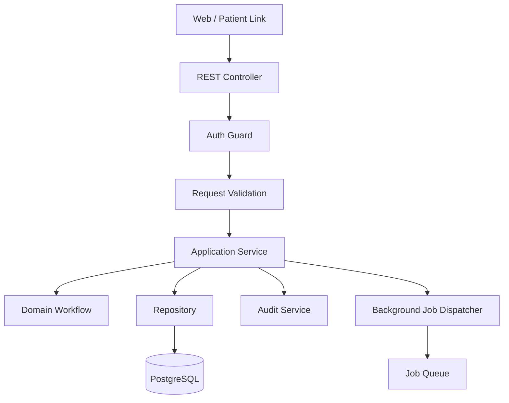

# 04 - API Architecture

## API Mandate

ClinicFlow APIs must expose operational workflows clearly and safely. The API exists to support:

- Staff command center.
- Patient intake and confirmation links.
- Task ownership.
- Follow-up reliability.
- Manager dashboards.
- Auditability.
- Future integrations.

Use REST-first API architecture with OpenAPI documentation.

## API Design Principles

- Workflow endpoints should be explicit.
- State changes must create audit events.
- All tenant data must be organization-scoped.
- Patient-facing endpoints must use short-lived secure tokens.
- Avoid generic update endpoints for sensitive state transitions.
- Keep API contracts stable and versioned.
- Return operationally useful errors.

## API Layers

## Versioning

Use URL versioning:

- `/api/v1/...`

Do not expose unversioned production endpoints.

## Endpoint Groups

### Organizations

Purpose: organization and location configuration.

Representative endpoints:

- `GET /api/v1/organizations/current`
- `GET /api/v1/locations`
- `POST /api/v1/locations`
- `PATCH /api/v1/locations/{locationId}`

### Users And Roles

Purpose: staff access and role management.

Representative endpoints:

- `GET /api/v1/users`
- `POST /api/v1/users`
- `PATCH /api/v1/users/{userId}/role`
- `PATCH /api/v1/users/{userId}/location-access`

### Patients

Purpose: minimum necessary patient registry.

Representative endpoints:

- `GET /api/v1/patients`
- `GET /api/v1/patients/{patientId}`
- `POST /api/v1/patients`
- `PATCH /api/v1/patients/{patientId}/contact-preferences`

### Appointments

Purpose: appointment command center and readiness state.

Representative endpoints:

- `GET /api/v1/appointments?date=&locationId=&status=&readinessStatus=`
- `GET /api/v1/appointments/{appointmentId}`
- `POST /api/v1/appointments`
- `POST /api/v1/appointments/{appointmentId}/confirm`
- `POST /api/v1/appointments/{appointmentId}/request-reschedule`
- `POST /api/v1/appointments/{appointmentId}/cancel`
- `POST /api/v1/appointments/{appointmentId}/mark-arrived`
- `POST /api/v1/appointments/{appointmentId}/mark-no-show`
- `POST /api/v1/appointments/{appointmentId}/recalculate-readiness`

### Intake

Purpose: templates, patient completion, staff review.

Representative endpoints:

- `GET /api/v1/intake/templates`
- `POST /api/v1/intake/templates`
- `PATCH /api/v1/intake/templates/{templateId}`
- `GET /api/v1/appointments/{appointmentId}/intake`
- `POST /api/v1/appointments/{appointmentId}/intake/send-link`
- `POST /api/v1/intake/submissions/{submissionId}/review`

Patient-facing token endpoints:

- `GET /api/v1/patient-link/intake/{token}`
- `POST /api/v1/patient-link/intake/{token}/submit`

### Communications

Purpose: reminders, confirmations, inbound responses.

Representative endpoints:

- `POST /api/v1/appointments/{appointmentId}/communications/send-reminder`
- `GET /api/v1/appointments/{appointmentId}/communications`
- `POST /api/v1/webhooks/messaging/inbound`
- `POST /api/v1/webhooks/messaging/status`

### Tasks

Purpose: ownership, due dates, aging, escalation.

Representative endpoints:

- `GET /api/v1/tasks?status=&ownerId=&locationId=&dueBefore=`
- `POST /api/v1/tasks`
- `PATCH /api/v1/tasks/{taskId}/assign`
- `PATCH /api/v1/tasks/{taskId}/status`
- `POST /api/v1/tasks/{taskId}/escalate`

### Follow-Ups

Purpose: follow-up reliability.

Representative endpoints:

- `GET /api/v1/follow-ups?status=&ownerId=&dueBefore=`
- `POST /api/v1/follow-ups`
- `PATCH /api/v1/follow-ups/{followUpId}/status`
- `POST /api/v1/follow-ups/{followUpId}/send-message`

### Metrics

Purpose: buyer-visible KPI reporting.

Representative endpoints:

- `GET /api/v1/metrics/today`
- `GET /api/v1/metrics/trends?from=&to=&locationId=`
- `GET /api/v1/metrics/pilot-success`

### Imports

Purpose: manual and CSV onboarding.

Representative endpoints:

- `POST /api/v1/imports/appointments`
- `GET /api/v1/imports/{importId}`
- `GET /api/v1/imports/{importId}/errors`

### Audit

Purpose: inspect activity history.

Representative endpoints:

- `GET /api/v1/audit?entityType=&entityId=&from=&to=`

## Request Validation

All requests must be validated before hitting application services.

Validation must enforce:

- Required fields.
- Allowed enum values.
- Organization and location scope.
- Date/time correctness.
- Patient communication consent.
- State transition validity.

## State Transition Rules

State-changing endpoints must:

1. Authenticate actor.
2. Authorize organization and location access.
3. Validate transition.
4. Apply transaction.
5. Emit audit event.
6. Dispatch background jobs if needed.
7. Return updated resource.

## Error Model

Use consistent error responses:

- `400` invalid request.
- `401` unauthenticated.
- `403` unauthorized or wrong organization/location.
- `404` not found within authorized scope.
- `409` invalid workflow state transition or conflict.
- `422` validation failed for domain-specific rules.
- `429` rate limited.
- `500` internal error with correlation ID.

Errors should include:

- code.
- message.
- correlation_id.
- field_errors when applicable.

## Idempotency

Use idempotency keys for:

- Sending reminders.
- Creating imports.
- Creating patient-facing links.
- Webhook processing.
- Appointment workflow actions that may be retried.

## Webhooks

Messaging webhooks must:

- Verify provider signature.
- Be idempotent.
- Store raw metadata only as needed.
- Map delivery and inbound states to communication events.
- Never update appointment state without domain validation.

## OpenAPI Standard

Every production endpoint must be documented with:

- Purpose.
- Authentication requirement.
- Required role.
- Request schema.
- Response schema.
- Error responses.
- Audit behavior.
- Side effects.

## API Acceptance Criteria

API design is ready when:

- All MVP workflows have endpoint coverage.
- Patient-facing token flow is defined.
- State transition rules are documented.
- Webhook validation and idempotency are defined.
- OpenAPI generation path is selected.
- Every endpoint has an authorization rule.
