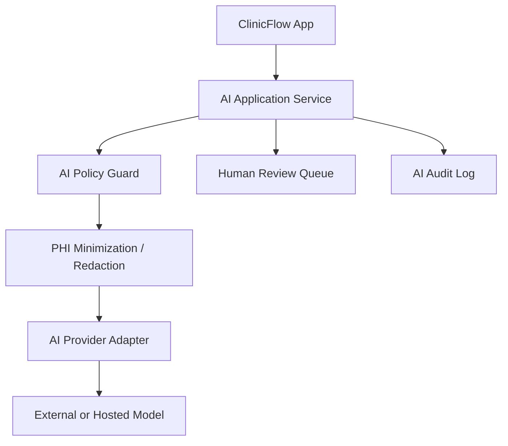

# 06 - AI Architecture

## AI Mandate

ClinicFlow must avoid autonomous clinical advice, diagnosis, triage, and treatment recommendations.

The Product Bible explicitly rejects clinical AI advice in MVP and postpones predictive no-show AI. AI is optional, constrained, and must only support operational workflows after the core product proves value.

## MVP AI Decision

No AI-powered decisioning in MVP.

MVP should rely on:

- Explicit workflow states.
- Configurable rules.
- Human review.
- Operational dashboards.
- Measured process improvement.

This protects ClinicFlow from:

- Unsafe clinical inference.
- Unvalidated prediction.
- Biased no-show scoring.
- Staff distrust.
- Compliance risk.
- Implementation delays.

## Allowed Future AI Use Cases

AI may be considered after MVP only for non-clinical operational support:

| Use Case | Status | Human Review Required |
| --- | --- | --- |
| Draft reminder or follow-up message variants | Later | Yes |
| Classify inbound non-clinical patient replies | Later | Yes for uncertain cases |
| Summarize operational bottlenecks for managers | Later | Yes before external reporting |
| Suggest task prioritization based on rules plus historical patterns | Later | Yes |
| Generate staff-facing weekly KPI narrative | Later | Yes |

## Rejected AI Use Cases

Do not build:

- Diagnosis suggestions.
- Clinical triage.
- Treatment recommendations.
- Medication advice.
- Autonomous prior authorization submissions.
- Autonomous patient risk scoring.
- Predictive no-show penalties or deprioritization.
- Any AI that hides rationale from staff.

## AI Architecture If Added Later

## AI Provider Abstraction

If AI is added later, use a provider adapter.

Adapter responsibilities:

- Model provider selection.
- Request formatting.
- Response normalization.
- Timeout handling.
- Retry policy.
- Content filtering.
- Audit metadata.
- Cost tracking.

The core product must not depend directly on one AI provider SDK.

## AI Guardrails

All AI features must enforce:

- No autonomous clinical communication.
- No diagnosis, triage, or treatment language.
- No hidden patient-facing messages.
- No use without tenant-level enablement.
- No model training on customer data unless contractually approved.
- PHI minimization before model calls.
- Human approval for patient-visible content.
- Audit logs for prompt, response metadata, reviewer, and final action.

## AI Data Policy

Before sending anything to an AI provider:

- Remove unnecessary identifiers.
- Include only operational context needed for the task.
- Avoid free-text clinical notes.
- Prefer structured operational states over raw patient text.
- Store model outputs separately from source-of-truth workflow state.

## AI Evaluation Requirements

Any AI feature requires:

- Written feature justification tied to Product Bible KPIs.
- Test set from de-identified or synthetic data.
- Accuracy and failure-mode review.
- Bias review where patient access could be affected.
- Human review workflow.
- Rollback plan.
- Customer opt-in.

## AI Observability

Track:

- Feature usage.
- Accepted vs edited suggestions.
- Rejected suggestions.
- Error rate.
- Latency.
- Cost.
- Patient-visible message approval rate.
- Reported unsafe or incorrect output.

## Recommended First AI Experiment Later

The safest first AI-assisted feature is manager-facing operational summarization:

- Input: aggregate metrics and task queues.
- Output: draft explanation of today's bottlenecks.
- User: clinic manager.
- Risk: low, because it does not speak to patients or make clinical decisions.
- Guardrail: manager can ignore or edit.

Do not implement this in MVP.

## Acceptance Criteria

AI architecture is ready when:

- MVP explicitly has no AI decisioning.
- Future AI provider abstraction is documented.
- Prohibited use cases are clear.
- Human review and audit requirements are defined.
- PHI minimization policy is documented.
