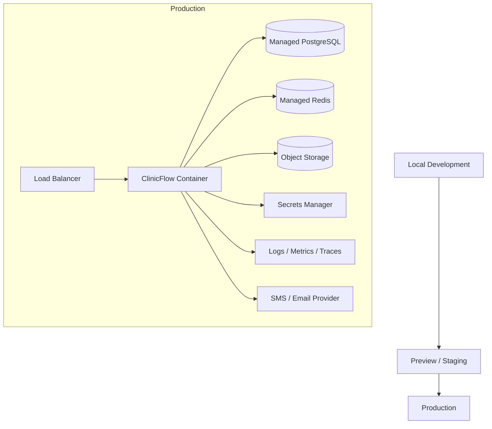
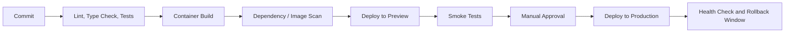

# 07 - Deployment Architecture

## Deployment Mandate

ClinicFlow must be deployable, observable, secure, and simple enough for an MVP pilot.

The system should start as a containerized modular monolith with managed infrastructure, then scale components only when usage demands it.

## Recommended Deployment Model

Use managed cloud services:

- Containerized web/API application.
- Managed PostgreSQL.
- Managed Redis.
- Managed object storage.
- Managed secrets.
- Managed logs and metrics.

Avoid self-managed servers for the MVP.

## Environment Architecture

## Environments

### Local

Purpose:

- Developer workflow.
- Unit tests.
- Local integration tests.

Uses:

- Local app.
- Local PostgreSQL or managed dev database.
- Local Redis.
- Mock messaging provider by default.

### Preview / Staging

Purpose:

- QA.
- Security review.
- Demo data validation.
- Pre-production migration tests.

Uses:

- Separate database.
- Separate Redis.
- Sandbox messaging provider.
- Synthetic or approved test data only.

### Production

Purpose:

- Pilot and live usage.

Uses:

- Production database.
- Production Redis.
- Production secrets.
- Production messaging credentials.
- Strict access controls.
- Backups enabled.

## Deployment Pipeline

## Release Requirements

Every production release must include:

- Passing tests.
- Successful build.
- Migration review.
- Rollback plan.
- Smoke test checklist.
- Health check after deploy.
- Release note for operational changes.

## Secrets Management

All secrets must live in a secrets manager or platform secret store.

Never commit:

- Database URLs.
- Messaging credentials.
- Auth provider secrets.
- Encryption keys.
- Webhook signing secrets.
- AI provider keys.

## Database Deployment

Migrations must run intentionally.

Policy:

- Apply migrations to staging first.
- Back up production before risky migrations.
- Prefer backward-compatible migrations.
- Deploy app compatibility before removing old fields.
- Keep rollback instructions with each migration.

## Background Jobs Deployment

MVP can run web and worker processes from the same codebase but separate runtime commands.

Processes:

- Web/API process.
- Worker process for reminders, imports, metrics, escalations.
- Optional scheduler process for recurring jobs.

Do not run long jobs in web request handlers.

## Health Checks

Required checks:

- App liveness.
- Database connectivity.
- Redis connectivity.
- Job queue health.
- Messaging provider webhook availability.
- Migration version.

## Backups

Production must have:

- Automated PostgreSQL backups.
- Point-in-time recovery if available.
- Backup restore test before real PHI pilot.
- Object storage retention policy.

## Rollback Strategy

Use:

- Container image rollback.
- Backward-compatible database migrations.
- Feature flags for risky workflows.
- Disable messaging jobs quickly if patient communication bug occurs.

Emergency kill switches:

- Disable reminder sending.
- Disable patient links.
- Disable imports.
- Disable support access.

## Initial Hosting Options

Acceptable MVP hosting categories:

- Render, Fly.io, Railway, or similar managed container platform for fast pilot.
- AWS ECS/Fargate, Google Cloud Run, or Azure Container Apps for stronger enterprise alignment.

Decision criteria:

- Security review requirements.
- HIPAA/BAA needs.
- Team operational skill.
- Pilot customer expectations.
- Cost.

If handling real PHI, choose infrastructure and vendors that support required contractual and compliance obligations.

## Acceptance Criteria

Deployment architecture is ready when:

- Hosting target is selected.
- Environments are created.
- Secrets strategy is defined.
- Production backup strategy is verified.
- Health checks are documented.
- Rollback plan is documented.
- Worker process is separated from web requests.
