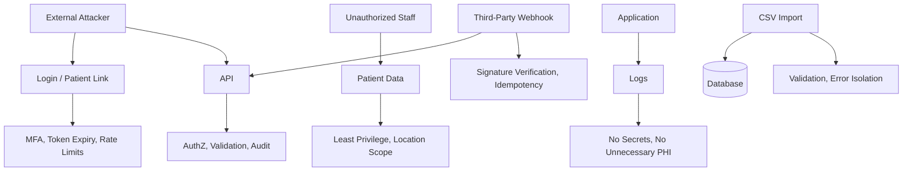

# 08 - Security Architecture

## Security Mandate

ClinicFlow may handle protected health information. Security must be designed before implementation, not patched in later.

The Product Bible requires:

- Minimum necessary data.
- Role-based permissions.
- Audit and access basics.
- Patient communication consent.
- Avoidance of clinical automation.
- Staff trust and operational reliability.

## Security Principles

- Minimum necessary data collection.
- Least privilege access.
- Organization and location scoped authorization.
- Secure by default.
- Audit every sensitive state change.
- Encrypt data in transit and at rest.
- Isolate vendor dependencies.
- Fail safely.

## Data Classification

| Data Type | Examples | Sensitivity |
| --- | --- | --- |
| Account data | User email, role, location access | Confidential |
| Patient identity | Name, DOB, contact details | PHI |
| Appointment data | Date, provider, visit type, status | PHI / Operational |
| Intake metadata | Completion status, missing item count | PHI / Operational |
| Communication metadata | Sent, delivered, response status | PHI / Operational |
| Audit logs | Actor, action, entity, before/after state | Sensitive |
| Metrics | Aggregated counts and trends | Confidential, lower PHI risk if de-identified |

## Minimum Necessary Policy

MVP must avoid storing:

- Diagnosis.
- Clinical notes.
- Medication lists.
- Lab results.
- Billing records.
- Insurance claim details.
- Free-form clinical histories unless explicitly approved.

Store only operational fields required for appointment readiness, intake status, task ownership, follow-up, and KPI reporting.

## Threat Model

## Authentication Controls

- MFA for admins and managers.
- Strong session management.
- Secure cookies.
- Session revocation.
- Password reset through approved auth provider.
- SSO support path for enterprise pilots.
- Rate limiting on login and patient token endpoints.

## Authorization Controls

- RBAC plus organization scope.
- Location access checks for operational data.
- Patient links scoped to one action.
- No global patient search for non-admin users unless justified.
- Support access disabled by default and audited.

## Patient Link Security

Patient links must:

- Use high-entropy tokens.
- Expire.
- Be revocable.
- Be scoped to a single appointment/action.
- Avoid sensitive data in URL.
- Rate-limit attempts.
- Avoid exposing full patient record.

## Encryption

Required:

- TLS for all traffic.
- Encryption at rest for database.
- Encryption at rest for object storage.
- Encrypted backups.
- Secure key management through hosting provider or secrets manager.

Consider application-level encryption for especially sensitive fields after pilot requirements are known.

## Audit Logging

Audit:

- Patient data access where feasible.
- Patient data changes.
- Appointment state changes.
- Intake submission and review.
- Reminder sending.
- Patient response handling.
- Task assignment and completion.
- Follow-up creation and completion.
- Role and permission changes.
- Imports.
- Support access.

Audit logs must be append-only at application level.

## Secure Development

Required practices:

- Dependency scanning.
- Static checks.
- Secret scanning.
- Type checking.
- Input validation.
- Output encoding.
- CSRF protection where applicable.
- Secure headers.
- Review of all patient communication workflows.

## Logging Policy

Logs must not include:

- Authentication secrets.
- Patient tokens.
- Full message content unless explicitly required and protected.
- Full import file contents.
- Unnecessary patient details.

Logs should include:

- Correlation ID.
- Organization ID.
- User ID where applicable.
- Event type.
- Error code.

## Vendor Security

Before production with real patient data:

- Confirm vendor security posture.
- Confirm contractual requirements such as BAA where needed.
- Confirm data retention.
- Confirm breach notification terms.
- Confirm region and storage controls.

Applies to:

- Hosting provider.
- Database provider.
- Auth provider.
- Messaging provider.
- Observability provider.
- Object storage.
- AI provider if ever enabled.

## Incident Response

Minimum incident plan:

1. Disable affected workflow.
2. Preserve logs.
3. Identify affected organization and data.
4. Rotate secrets if needed.
5. Notify internal owner.
6. Follow customer contractual notification process.
7. Document root cause and corrective actions.

Emergency switches:

- Stop outgoing reminders.
- Disable patient links.
- Disable imports.
- Revoke support access.
- Disable integration webhooks.

## Compliance Notes

ClinicFlow should be designed for HIPAA-aligned controls if real PHI is used.

This architecture does not by itself make the product compliant. Compliance requires:

- Policies.
- Vendor agreements.
- Risk assessment.
- Access reviews.
- Incident procedures.
- Workforce controls.
- Customer-specific legal review.

## Acceptance Criteria

Security architecture is ready when:

- Data classification is approved.
- Minimum necessary field set is approved.
- Auth and RBAC model is accepted.
- Audit event list is mapped.
- Vendor review checklist is complete.
- Patient token rules are defined.
- Logging policy is implemented in standards.
